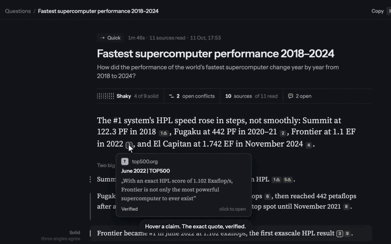

# Quorum


[](https://github.com/krzysztoff1/quorum/actions/workflows/tests.yml)


**Ask one question. Quorum runs blind, parallel, read-only research agents and reconciles the
results into one short, cited answer.** It's a native macOS app: a UI over
the `quorum-engine`, which drives the Claude Code CLI. The agents are read-only, so a failed
run wastes spend but can't touch your files.

---

## Demo

[](docs/demo.mp4)

[Watch the 75-second film](docs/demo.mp4). Ask a question, watch the five stages, hover a cited sentence to see the exact quote, open the source with the quote highlighted, jump between questions with ⌘K.

---

## Why Quorum

- **Explore every angle.** One question becomes N blind, parallel angles. A final summariser
  reconciles them, weights sources by cross-angle support, and flags conflicts.

- **Short answer you can trust.** Every sentence cites a stored quote. Click a chip and the source
  opens beside the prose with the quote highlighted. Numbers that are not in their quote are flagged.

- **Quick or Deep.** Quick answers within a hard 4:30 wall. Deep fans out wider and checks harder.
  Follow-ups stay in the same question thread.

- **Read-only and bounded.** Agents only search and fetch. The engine stops a run on its time and spend
  walls, so a failed run can't touch your files.

- **Plain files you own.** Each run is a folder under `~/Quorum` (`run.json`, events, evidence), and the
  answer is exported as markdown. No database and no cloud.

- **No second login.** Quorum reuses your Claude Code CLI sign-in. There are no API keys, no profiles
  and no model pickers.

## Benchmark

Two runs on 2026-07-04 put Quorum (Sonnet 5) against two baselines on the same four questions spanning
chemistry and tech — PFAS destruction, RAG vs. long-context, PQC migration, and AI training chips. A
third Claude call judged the writeups **blind** (order randomized, told not to reward length) on
groundedness, comprehensiveness, honesty, and clarity. The harness was removed from `main` in the one-pipeline step (PRD 10 M2). Its method, prompts and
judges are preserved at the annotated tag `benchmark-final` (`git show benchmark-final:Sources/Quorum/Benchmark.swift`),
and the raw writeups live in `.scratch/benchmark/<stamp>/`.

- **vs. plain Claude Code** — same model, effort, and read-only tools on both arms, so the **only**
  variable is the fan-out. This run isolates architecture — but the plain arm is a *vanilla* call, not
  Claude Code's `/deep-research` skill (see limitations).
- **vs. ChatGPT Deep Research** (GPT-5.5, highest thinking) — product vs. product, so a win here
  **isn't** attributable to architecture. Quorum ran on Sonnet 5, smaller than DR's GPT-5.5.

Quorum is the shared opponent in both blind matchups: each baseline was judged head-to-head against the
**identical** Quorum writeups (never against each other), and the judge re-scored Quorum in each
session — so its two columns can differ.

| Metric                         | Plain Claude Code | ChatGPT Deep Research | Quorum        |
| ------------------------------ | ----------------- | --------------------- | ------------- |
| Blind judge wins               | 0 / 4             | 0 / 4                 | **4 / 4**     |
| Groundedness                   | 6.5               | 6.0                   | **8.3 / 8.0** |
| Comprehensiveness              | 6.8               | **8.5**               | **9.5** / 8.0 |
| Honesty                        | 6.8               | 6.3                   | **9.0 / 9.0** |
| Clarity                        | **9.0**           | 5.5                   | 6.3 / **8.0** |
| Distinct sources cited (avg/Q) | ~10               | ~36                   | ~38           |

_Axis rows are blind-judge averages (0–10) over the four questions; **bold** marks the winner of that
matchup. Quorum's two numbers are its score **vs. plain Claude / vs. Deep Research**. "Sources" counts
distinct source URLs in each final judged writeup._

**Read it as:** Quorum wins groundedness and honesty in both matchups, cites ~4× more distinct sources
than a single plain-Claude call, and matches Deep Research on source breadth. Its one consistent
weakness is **clarity** — reconciling N writeups runs longer and messier, and plain Claude beat it on
clarity all four times. Comprehensiveness splits: Quorum crushes plain Claude but loses to Deep
Research's broader coverage and bigger tables. That DR keeps losing honesty and groundedness anyway
suggests the edge comes from the **architecture** — conflict flags, confidence levels, citation
checks — not raw model power.

### Honest limitations

- **n = 4** — a spot check, not a statistically powered study.
- **The plain-Claude arm didn't use `/deep-research`.** Claude Code ships a `/deep-research` skill that
  itself fans out searches, adversarially verifies claims, and writes a cited report — much closer to
  what Quorum does. The baseline was a plain call without it, so this shows Quorum beating *vanilla*
  Claude Code, not its strongest research mode. That fairer bar is untested.
- **LLM judge** — Claude judging, with known length/confidence bias, and Quorum's synthesis is
  structurally longer. Next step validate with multiple models
  ([#3](https://github.com/krzysztoff1/quorum/issues/3)).
- **Not all wins are equally strong** — Q1-PFAS, Q2-RAG, and Q3-PQC reward conflict tracking and
  confidence discipline and are clearer wins than Q4-chips, where ecosystem breadth favors the baselines.
- **Only the plain-Claude run isolates architecture**; the Deep Research comparison is the whole
  product, Claude scoring Claude-family output against OpenAI's.

## How it works

```
   your question ─▶ scoping (a few clarifying taps, then the resolved question)
          │
          ▼
   engine planner decomposes into N angles
          │
          ▼
   N blind read-only agents in parallel ─▶ summariser reconciles, cites, flags conflicts
          │
          ▼
   validators check the answer against its own sources ─▶ one cited answer + run.json
```

The engine (`quorum-engine run`) is the only pipeline and the only writer of a run. The app asks the
question, shows the five stages while it runs, and renders `run.json`: an inbox of questions, each a short
thread (scoping → answer → follow-ups), with an answer page, a source rail and a ⌘K palette. Several runs
can go at once, and a menu-bar item shows progress with **Stop all**.

## Build / run / test

```sh
swift test          # the app's logic, deterministic, no network, no spend
swift build         # builds QuorumCore + the app
swift run Quorum    # launch the app
cd engine && bun install && bun run typecheck && bun run test && bun run test:e2e
```

**Requires:** macOS 14+, Swift 6 toolchain (Xcode), `bun` for the engine, and the **Claude Code CLI**
installed and signed in (`claude` on your `PATH`).

The app looks for an engine in a fixed order: `QUORUM_ENGINE_BIN`; in a checkout, the engine from source
(`bun engine/src/index.ts`); the bundle; then `engine/dist/quorum-engine`. It handshakes with each
(`quorum-engine version`) and uses only one speaking exactly this app's protocol. If none passes, Run is
disabled and **Open Doctor** says why. Build a binary with `scripts/bundle-engine.sh`.

**Dogfood the installed app, not `swift run`:** `scripts/install.sh` builds a release `Quorum.app` with the
freshly built engine inside and replaces `~/Applications/Quorum.app`. `scripts/canary.sh` runs one cheap live
run through the installed engine and audits it with `quorum-engine check`; see
[docs/architecture/m3-verification.md](docs/architecture/m3-verification.md).

**Replay (dev only):** `QUORUM_REPLAY_FIXTURE=$PWD/engine/fixtures/mock-run.ndjson swift run Quorum` makes every
run a replay through `quorum-engine run --replay`, with no keys and no spend. Regenerate the fixture with
`python3 scripts/generate-mock-run.py`.

## Shape

- **`Sources/QuorumCore`** — pure logic, no AppKit, fully tested: the generated run-record types, the engine
  stream parser and resolution, the inbox / thread / palette / key-router models, scoping, the answer spec.
- **`Sources/Quorum`** — the SwiftUI app and the only impure code: engine client, views, `MacServices`
  (sleep prevention, notifications, the CLI probe). Settings keeps the store location, notifications, the
  terminal for "Open in Claude Code", and Doctor.
- **`engine/`** — the TypeScript/Bun `quorum-engine`: planner, parallel angles through the Claude Code CLI,
  grounding, validators, the answer spec and the run record. `engine/src/frozen/` holds the BYOK (AI SDK),
  Codex and single-topic code that nothing on the default path imports; see [engine/README.md](engine/README.md).

Architecture detail: [docs/architecture/current-architecture.md](docs/architecture/current-architecture.md).

## The brain on disk

Everything lands in `~/Quorum` (change it in Settings):

```
~/Quorum/
├── questions/<question_id>/
│   ├── question.json
│   └── runs/<run_id>/             # run.json, events.ndjson, evidence/, transcripts/
├── answers/<slug>-<id>.md         # markdown export of each finished run
└── ui-state.json                  # app-owned: what you have read
```

## Getting started

```sh
git clone https://github.com/krzysztoff1/quorum.git && cd quorum
swift run Quorum
```

Ask a question. There's no API key or extra setup — Quorum uses your existing Claude Code CLI login.
