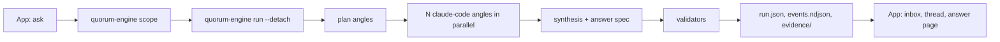

# Current architecture

What is left after the migration (M1-M10). Earlier versions of this page mapped the pre-rethink app; that app is
gone. The reasoning is in [PRD 10](10-architecture-rethink.md), the step notes are linked from the
[docs index](../README.md).

## One pipeline, one record

- **Engine** (`engine/src`, TypeScript on Bun): the only pipeline and the only writer of a run. Every model call
  is a `claude` CLI session (`claudeCode.ts`); the wall and tier logic is data (`tiers.ts`, `wall.ts`); the record
  schema is `record/schema.ts`; the answer is a validated QVS spec (`answer/`).
- **App** (`Sources/Quorum`, SwiftUI): a thin client. It launches the engine (`QuorumEngine`, `EngineRunClient`),
  watches `events.ndjson` and renders `run.json`. It holds no research logic, no keys and no notes.
- **Core** (`Sources/QuorumCore`): the pure, tested logic behind the views: the generated record types, the
  stream parser, `Inbox`, `QuestionThread`, `Palette`, `KeyRouter`, scoping, evidence and answer models.
- **Store** (`~/Quorum`): `questions/<id>/question.json`, `runs/<id>/{run.json,events.ndjson,evidence/}`,
  `answers/*.md`, and the app-owned `ui-state.json`. Nothing lives in the repo.

## Settings

Store location, notifications, the terminal used for "Open in Claude Code", and Doctor. There is no key entry,
no profile and no model choice: the app is Claude subscription only.

## Frozen

`engine/src/frozen/` keeps the BYOK (AI SDK), Codex, price-table and single-topic code, tested but off the
default path and out of the binary. `run` rejects any model outside `claude-code`. Tavily/Brave search stays in
`search.ts` as an optional env-key feature of `mcp-serve`.

## Verification

Swift: `swift test`. Engine: `bun run typecheck`, `bun run test`, `bun run test:e2e`. Live check: `scripts/canary.sh`.
The rungs and the PR rules are in [verification.md](verification.md) and [pr-checklist.md](pr-checklist.md).
