# M9: the new UI on the record

M9 replaces the old shell (Content / Compose / TopicDetail / FanOut / Notes) with shape C from the [UX proposal](../ux-rethink/PROPOSAL.md): an inbox of questions, each a short thread. The app renders what the engine wrote (`run.json`, `question.json`, `events.ndjson`, `evidence/`) and nothing else. The answer page is the D1 A+B merge from [answer-page.md](../design/answer-page.md).

Bar: Linear / Raycast in feel (dense, fast, keyboard-first, crisp dark, subtle motion), never in glyphs. No Linear priority bars, no half-filled or dashed status circles, no diamond milestones. Quorum's own icons are drawn in `Icons.swift` (deep = three-node fan, quick = lead line + dot, work = fan-out, gap = corner brackets) from the answer.html SVG paths.

## What it looks like

| | |
|---|---|
| 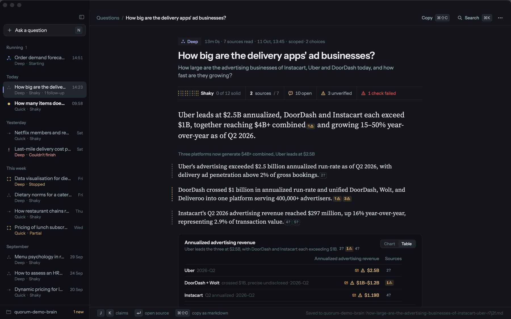 | 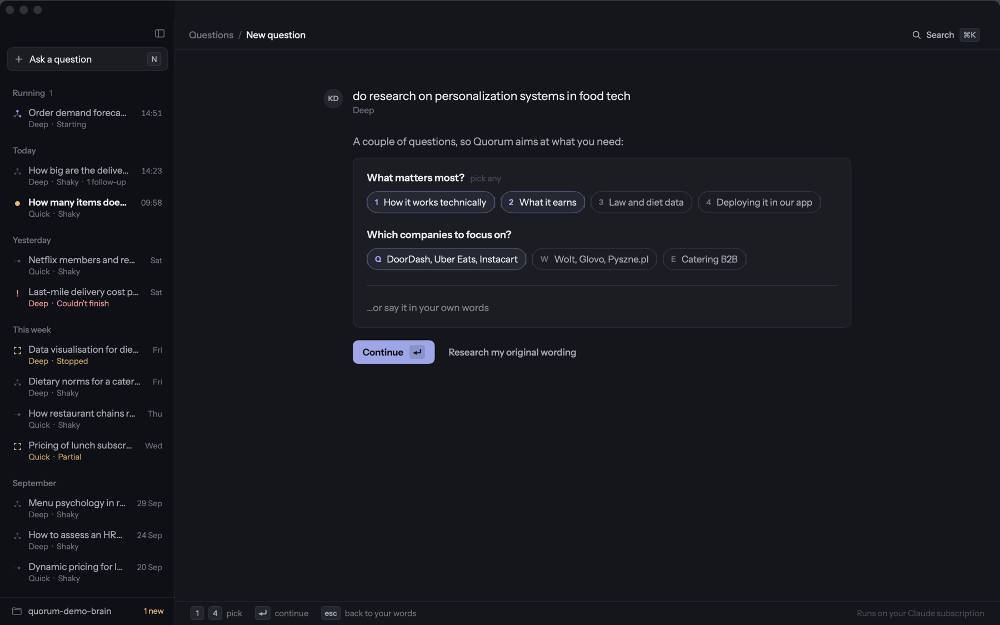 |
| Inbox + answer page. Running pinned on top, then Today / Yesterday / This week / month. Unread = amber dot + bold. | Scoping, the clarifying step. Keys 1-4 / Q-R / A-F pick. |
| 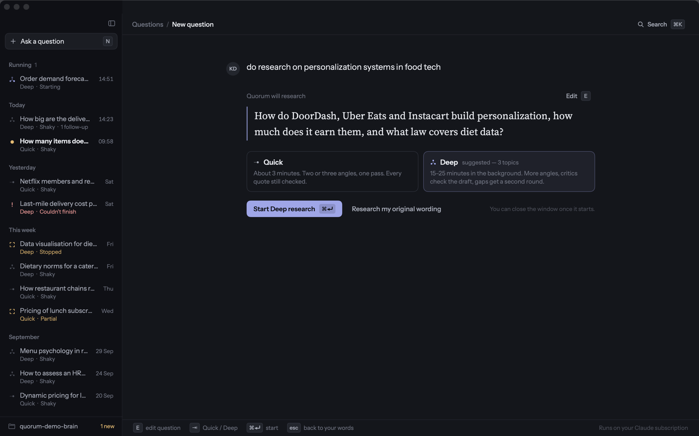 | 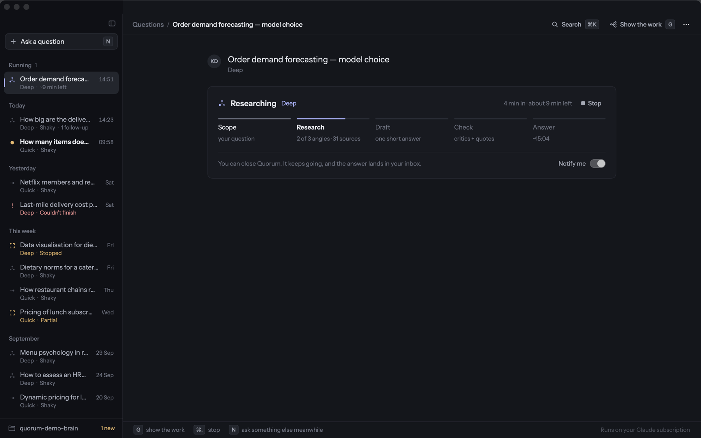 |
| Scoping, confirm card. The resolved question, depth pre-picked from the scope, ⇥ flips it, ⌘⏎ starts. | Running: five plain stages with an ETA, Stop, notify toggle. Nothing on it asks for a decision. |
| 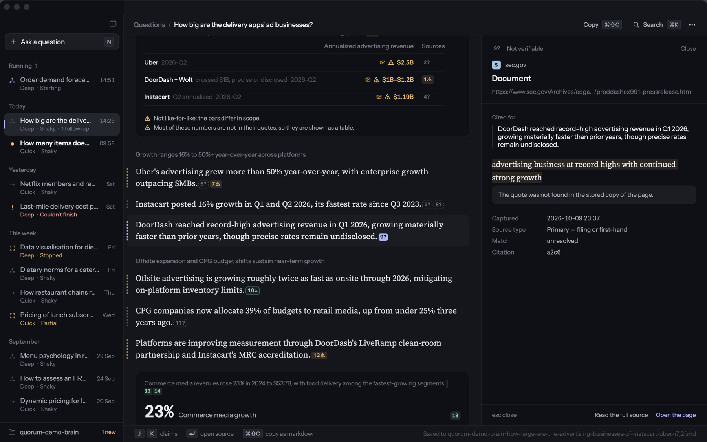 | 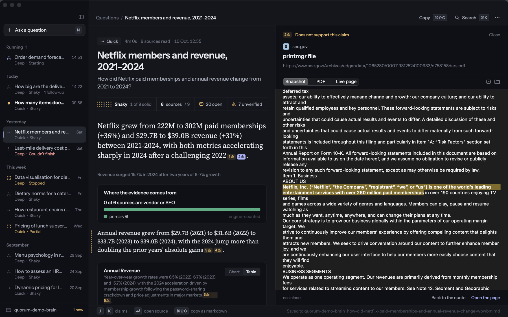 |
| Source rail: tier of the quote, claim it is cited for, the stored passage, source type, match. | "Read the full source": snapshot / PDF / live page, quote highlighted, rail widens to 660. |
| 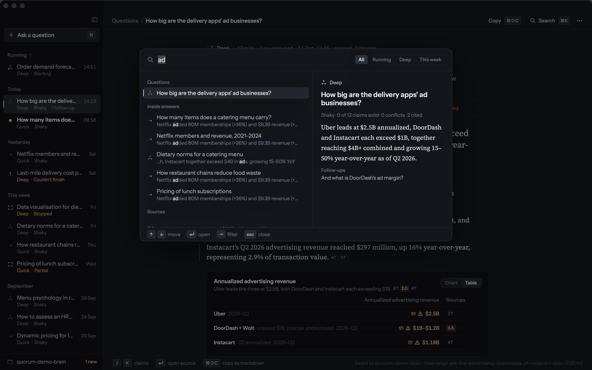 | 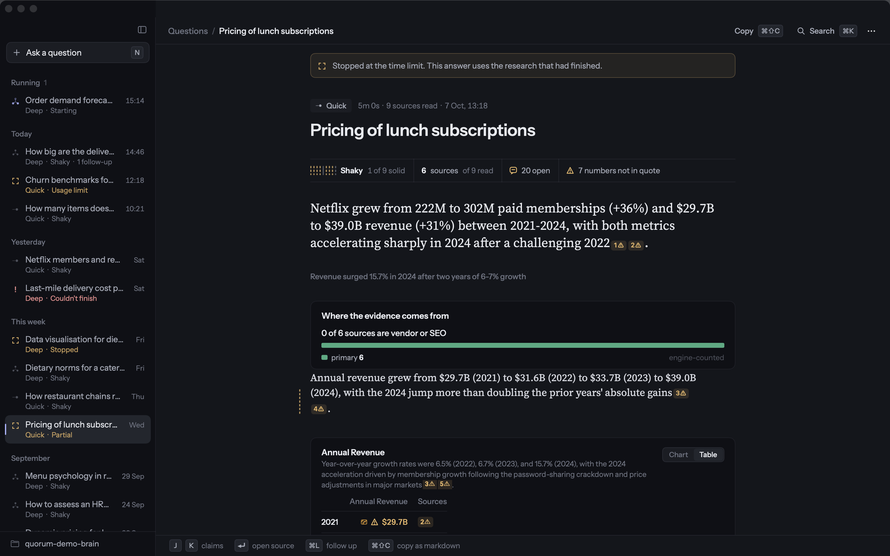 |
| ⌘K: questions, text inside answers, sources, ask-as-new, commands, filter chips, preview pane. | A partial answer says why above the answer (here the hard time limit), the strip keeps its unchecked marks. |
| 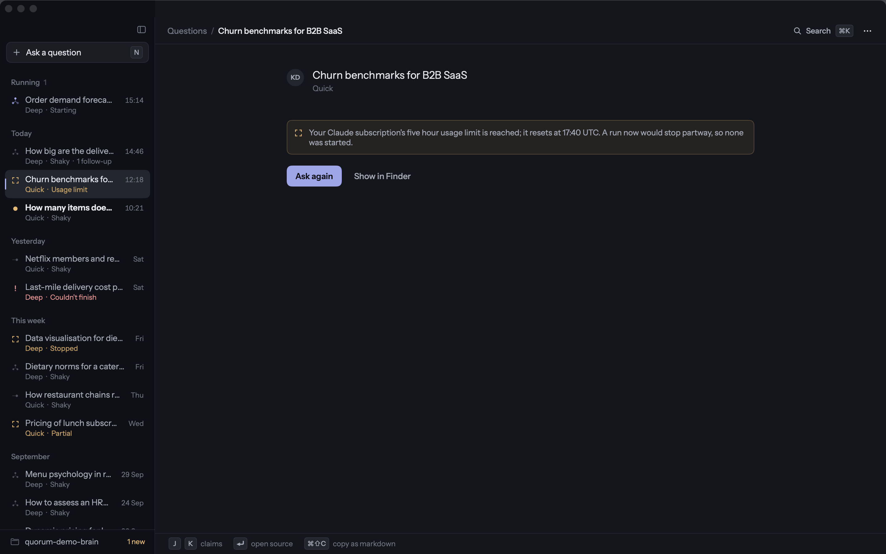 | |
| A run refused for the usage limit: the engine's reason with the reset time, Ask again, and "Usage limit" on the row. | |
| 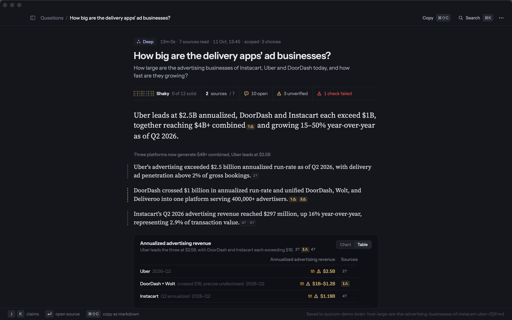 | 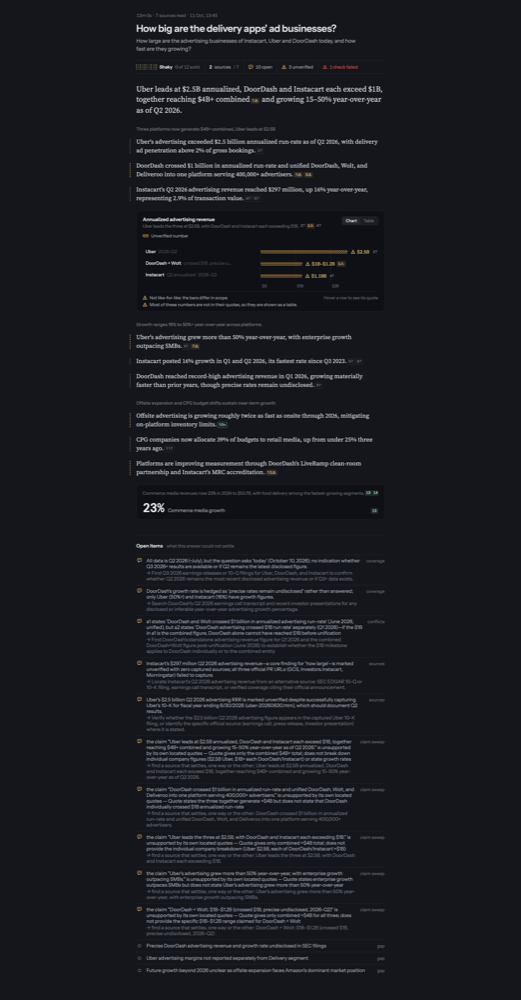 |
| ⌘\ hides the sidebar; the top bar grows a reveal button and clears the traffic lights. | Figure with unverified bars (hatched) in the headless render. |
| 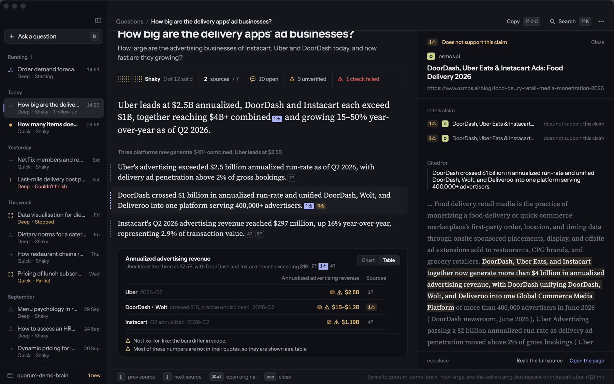 |  |
| J J ⏎ driven by synthetic key events: claim focus, scroll, rail open, linked chips light up, key bar switches to rail hints. | The same keys in the app installed by `scripts/install.sh` (build 8a349b6). |

All captured from the demo brain (`scripts/demo-brain.py`: two real M5 runs cloned with varied titles, tiers, statuses and dates) at 1440x900 with the `--shoot` hook, against the debug build and, for the last, the installed `~/Applications/Quorum.app`.

## Shape of the code

Everything with behaviour lives in `QuorumCore` and is tested; the app target is views and wiring.

| Core (tested) | What it decides |
|---|---|
| `QuestionThread`, `ThreadIndex` | runs grouped by `question_id`; current / shown answer / earlier answers / follow-ups / running run |
| `UIState` | `ui-state.json` (app-owned): when each question was last read, so unread is "finished after read" |
| `Inbox` | sections (Running pinned, then by day), rows (state, tier, parts, unread), j/k stepping, menu-bar summary |
| `KeyRouter`, `KeyScope.resolve` | every shortcut, by scope (list, composer, question, rail open, scoping step, palette) and whether a text field has focus |
| `Palette` | grouped search, filters, preview, commands; ranking is the old `QuickSwitch` ranking |
| `ClaimNavigator` | J/K claim focus, source cycling, rail open/close |
| `StageStrip` | five stages, detail line per stage, "4 min in, about 9 min left" |
| `ThreadPage` | what the thread offers: Go deeper, follow-up, earlier answers, which answer is being read |
| `RunVerdict`, `AnswerExport` | the one-line verdict (notification, partial banner) and the path of the exported answer |
| `RunConfig` (`EngineRunConfig`, `EngineCapabilities`) | the `run --detach` config from a `RunStart` (the tier, the brief and the thread fields, nothing about how hard to research); the `threads` doctor capability |

| App | |
|---|---|
| `AppShell`, `Sidebar`, `Chrome` | window, sidebar, top bar, key bar, motion tokens |
| `NewQuestionView`, `ComposerModel` | composer and the scoping flow (M7) restyled |
| `ThreadView` | progress card, answer host, follow-ups, earlier answers, Go deeper, docked follow-up field |
| `PaletteView` | ⌘K |
| `AnswerView`, `AnswerSourceRail`, `SourceInspector` | answer page, rail, full-source inspector (restyled; `CitedSourceInspector` is embedded in the rail) |
| `KeyDispatcher`, `AppModel+Commands` | one `NSEvent` monitor → `KeyRouter` → `AppModel.dispatch` |
| `Fonts`, `Icons`, `AnswerTheme` | bundled fonts, drawn icons, D1 tokens |

## Keyboard map

| Where | Keys |
|---|---|
| Anywhere | ⌘K search, ⌘N / N new question, ⌘\\ sidebar, ⌘1-9 jump to the nth question, ⌥↑ / ⌥↓ previous / next question |
| Thread | J / K claim, ⏎ open the claim's source, \] / \[ next / previous source, ⌘⏎ open original, esc close rail, E earlier answers, R research an open conflict, G show the work (running only), ⌘L follow-up, ⌘⇧C copy as markdown, ⌘. stop |
| Composer | ⏎ ask, ⇧⏎ newline, ⇥ Quick / Deep |
| Scoping | 1-4, Q-R, A-F pick, ⏎ continue, esc back to your words; confirm: ⌘⏎ start, E edit the question, ⇥ depth |
| Palette | ↑ ↓ move, ⏎ open, ⇥ filter, esc close |

Keys are ignored while a text field is editing, except the composer's own (⏎, ⇥) and ⌘ chords. Reduced motion zeroes every animation (`Motion` reads `accessibilityDisplayShouldReduceMotion`); rows, buttons and the rail carry VoiceOver labels.

## Decisions and deviations

- **E toggles earlier answers, not ⌥↑.** The proposal gave ⌥↑ to both list stepping and "expand earlier"; list stepping keeps it.
- **No progress rings.** The mockup's ring on running rows is close to a circular status glyph; running rows use the pulsing Quorum tier icon instead.
- **No early findings on the progress card.** The mockup streams unchecked findings while angles report. The engine emits none; the card shows stages, clock and ETA only.
- **Follow-ups skip scoping.** A follow-up is one line, default Quick, researched with the answer as context.
- **Go deeper and follow-ups sit behind the `threads` doctor capability.** The engine side is M8 (`kind: rerun | followup`, `parent_run_id`, `question_id`, doctor's `threads` check). The bundled engine reports it ok, so the buttons show in the installed app. `--assume-threads` is only for a build with no engine at all.
- **The app sends the tier and nothing else about effort.** M8 moved the table (angles, rounds, budgets, models, the Quick wall) into the engine; `TierPlan` and the per-run deadline are deleted from the app.
- **Fonts are bundled**: Instrument Sans and Source Serif 4 (roman + italic), both SIL OFL 1.1, licences next to the files in `Sources/Quorum/Resources/Fonts/`. Source Serif's optical size axis is set per size.
- **The live graph is read-only and only while running** (G). It is the existing canvas with its Audit and Validation tabs removed; a finished run has no graph surface.
- **"Partial"** is a real status now (M8): an amber banner above the answer says which limit cut it short (`limits.wall_hit` `hard` or `wind_down`), and the inbox row says Partial.
- **A rate-limited run** (`refusal.kind: rate_limited`) is shown in its own thread with the engine's reason, which carries the reset time, and its row says "Usage limit". It does not open the doctor sheet, which stays for environment problems (not logged in, engine failed).
- **The trust strip** drops to a compact form (`2 sources / 7`, `3 unverified`) and scrolls sideways before it ever clips.
- **A SwiftUI quirk**: when a thread moves from Running to Today, the old row view kept its stale content. Rows are keyed on id + state + unread to force a rebuild (not on the subtitle, so an ETA tick does not rebuild them). Found by running a real replay to completion.

## Deleted

Whole files: `Views.swift` (886 lines: ContentView, ComposeView, NoteTreeRows, TopicDetailView, FanOutView, SynthesisSummary, StatusBadge, RunDetailView), `FinishedRunView.swift` (251: RunHeaderStrip, ValidationTab), `ScopingView.swift` (393), `QuickSwitch.swift` view (102), `GuardrailMapper.swift` + `MapperTests.swift` (90), `RunHeader.swift` (63). The editor half of `MarkdownView.swift` (161), the Compose pickers in Settings (angle / synthesis model, Codex model, How to Use), `EffortPreset`, `ResearchTemplate`, `RunSettings`, `Depth` and `ResearchAngle.preset` from `Models.swift`, the Audit / Validation tabs of the graph rail, and the "Reads project" toggle (`useProjectContext` / `projectDir` in the run config and its UserDefaults key). With it gone the app never lets research agents read the current project; the engine still accepts the field, so bringing it back is a one-line UI change if it is wanted.

`git diff --shortstat origin/main`: 4776 insertions, 2748 deletions across 71 files (about 4.6k of the insertions are Core code, tests and views that are new in this milestone, with the tests included).

Kept: `ClaudeCodeLauncher` (Open in Claude Code, in the thread's ⋯ menu and the palette), the source inspector views, `ResearchGraphView` (read-only), `DoctorView`.

## How to reproduce the screenshots

```
python3 scripts/demo-brain.py /tmp/quorum-demo-brain
.build/out/Products/Debug/Quorum --brain /tmp/quorum-demo-brain --size 1440x900 \
  --select "delivery apps" --keys j,j,return --shoot out.png --shoot-after 5
```

Flags: `--brain`, `--select <id|title>`, `--palette [query]`, `--scope clarifying|confirming|scoping [--tier deep]`, `--fake-progress`, `--work`, `--claims N`, `--open-cite <id> [--full-source]`, `--hide-sidebar`, `--follow-up`, `--keys j,cmd+k,return,esc,...`, `--start "question"` (with `QUORUM_REPLAY_FIXTURE=engine/fixtures/mock-run.ndjson` it runs the replay engine offline end to end), `--size WxH`, `--shoot`, `--shoot-after`. The headless `--render <run.json> --out file.png` from M5 still works.

## Verification

- `swift test`: 514 tests, 0 failures. `bun run typecheck`, `bun run test` (860), `bun run test:e2e` (31) in `engine/` unaffected and green.
- `scripts/install.sh` builds and installs; the installed app loads the bundled fonts and renders the same screens.
- A real `run --detach --replay` run from the app: start → inbox row appears under Running → progress card → record lands → the thread switches to the answer, the exported markdown is written, the row leaves Running.
- Keyboard routing is unit-tested in `KeyRouterTests`; the live monitor was driven with synthetic `NSEvent`s (J, J, ⏎, \], esc, N, ⌘K) and the results read off screenshots. Real hardware keystrokes were not sent (the sandbox has no accessibility permission).
- No live canary run was made (weekly limit).

## Gaps, honestly

- **Never run against a live model.** The UI has only seen the demo brain, two real M5 runs and the offline replay.
- **Go deeper and follow-ups were not run for real.** The engine reports the capability and the config spells the fields as M8 reads them (engine tests cover that side), but no live thread was started from the GUI (weekly limit).
- **The rate-limit reset time is the engine's text** (`resets at 17:40 UTC`), not converted to local time; the record carries no date to convert.
- **No early findings, no progress ring** (above).
- **The follow-up field and the earlier-answers disclosure are not in a screenshot** (they need the `threads` capability and a scrolled page).
- **Focus rings** exist on the composer and the palette field; plain buttons rely on keyboard shortcuts and show no ring under Full Keyboard Access.
- **The segmented picker in the full-source inspector and the Notify switch** are still the system controls, a little lighter than the rest.
- **Light mode** is not designed; the window forces dark.
- **The graph canvas** while running is the old canvas in the old dress.

## Review follow-ups (Opus review of PR #20)

Behaviour that moved into `QuorumCore` so it is tested: `RunStartGate` (one start per question at a time), `AttachPlan` (a thread run never resets the composer draft or yanks the selection), `ThreadTrash` (stop, wait for the record to stop running, only then trash the folder and remove the answer export), `Expiring` (engine probe reused for 20 s), `FollowUpRequests` (seed and focus per question), `BrainSnapshot` (one off-main load: runs, threads, read state, exports), `RecentlyUsed` (answer pages reused across redraws), `DateText` (shared formatters). The inbox sections are computed once per change instead of on every read, the engine probe and the brain scan run off the main thread, the app reloads when it becomes active and after a brain-folder change (old watchers are cancelled), and runs the app cannot open show as "Couldn't open" rows with the reason.
